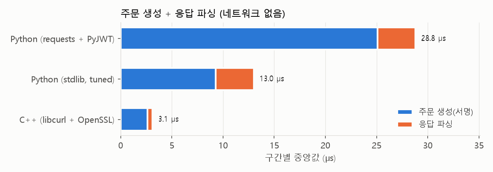
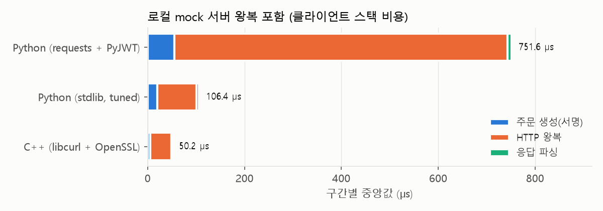
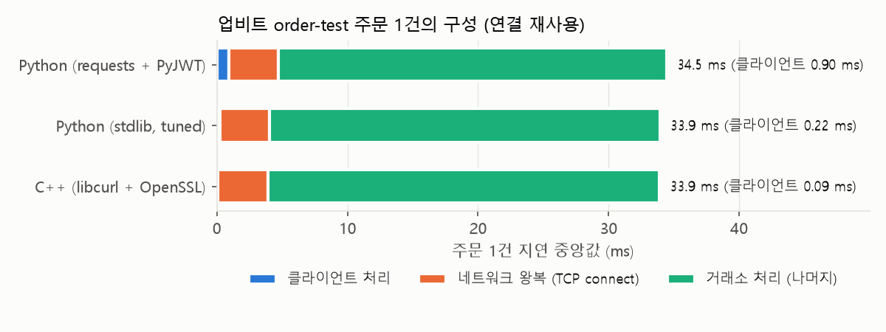
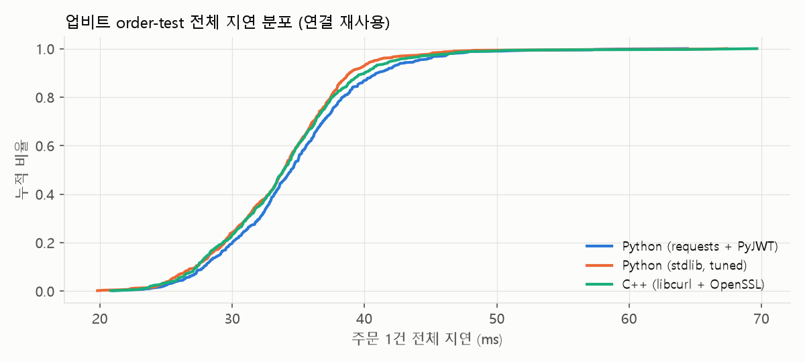
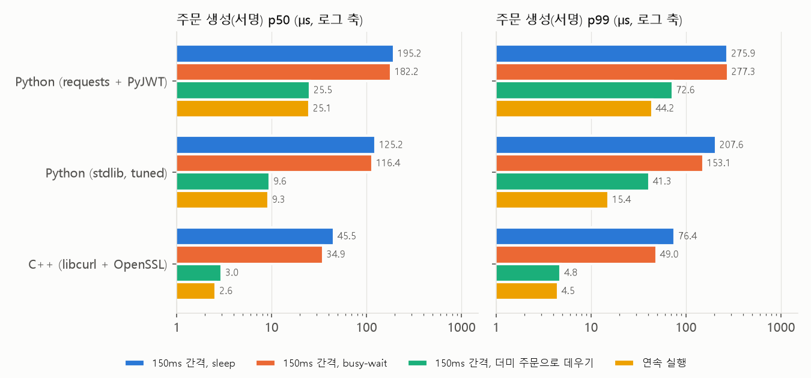

# order-latency-bench

**같은 업비트 주문 요청을 Python과 C++로 만들어 보내고, 주문 경로의 어느 구간에서 얼마나 시간이 쓰이는지 구간별로 나눠 잰 프로젝트입니다.**

"C++가 Python보다 빠르다"는 말이 주문 1건의 지연에서 실제로 몇 µs, 몇 %에 해당하는지 확인하는 것이 목표입니다.
그래서 언어 차이만 보지 않고, 같은 측정 안에서 라이브러리 선택, 네트워크, 거래소 처리, CPU 캐시 상태가 각각 얼마를 차지하는지도 함께 봤습니다.

## 결론

| | Python (requests + PyJWT) | Python (표준 라이브러리, 튜닝) | C++ (OpenSSL + libcurl) |
|---|---:|---:|---:|
| ① 주문 생성(서명) p50, 연속 실행 | 25.1 µs | 9.3 µs | **2.6 µs** |
| ② 로컬 서버 왕복 포함 p50 | 752 µs | 107 µs | **51 µs** |
| ③ 업비트 실서버 왕복 p50 | 34.5 ms | 33.9 ms | 33.9 ms |
| ③ 중 클라이언트 처리 몫 | 0.90 ms (2.6%) | 0.22 ms (0.6%) | **0.09 ms (0.3%)** |

1. **클라이언트 코드만 놓고 보면 C++가 확실히 빠릅니다.** 주문 생성은 공식 예제 방식 Python보다 약 10배, HTTP 처리를 포함하면 약 15배 빠릅니다.
2. **Python 지연의 상당 부분은 언어보다 라이브러리에서 나옵니다.** 같은 Python이라도 `requests`를 걷어내면 752 → 107 µs로 7배 빨라집니다. `requests` 한 번 호출의 절반(약 330 µs)은 요청마다 프록시 환경을 조회하는 비용이었습니다(아래 2절).
3. **공용 인터넷 API에서는 언어 차이가 결과를 거의 바꾸지 못합니다.** 업비트 실서버 왕복 34 ms 가운데 네트워크는 약 4 ms이고, 나머지 약 30 ms는 거래소 내부 처리입니다. C++와 Python의 차이(중앙값 기준 0.5 ms)는 왕복 시간 변동폭(p50 → p99 사이 13–16 ms)보다 훨씬 작습니다.
4. **같은 C++ 코드도 주문 사이에 쉬면 17배 느려집니다.** 연속 실행 2.6 µs인 서명이 150 ms 간격으로 실행하면 46 µs가 됩니다. busy-wait로 코어를 깨워 둬도 35 µs에 그쳤고, 대기 중에 더미 주문으로 경로를 계속 데워 두는 방법(cache warming)으로 3.0 µs까지 회복했습니다(아래 5절).

→ 지연에 민감한 시스템에서 C++의 이점이 의미를 가지려면, 거래소 처리 시간과 네트워크 왕복 시간이 줄어드는 환경(코로케이션, 전용 회선, 바이너리 프로토콜)이 함께 갖춰져야 합니다. 그 환경에서는 ①, ②의 µs 차이와 ⑤의 캐시 상태가 그대로 경쟁력이 됩니다.

## 무엇을 쟀나

주문 1건을 세 구간으로 나눠 구현마다 같은 지점에서 시간을 찍었습니다.

```
 [주문 생성]                          [HTTP 왕복]                    [응답 파싱]
 파라미터 직렬화 -> SHA-512 query_hash  요청 전송 -> 거래소 처리 -> 응답 수신   JSON -> uuid/state/error
 -> JWT(HS256) 서명 -> JSON 본문
```

- 대상 API: 업비트 [`POST /v1/orders/test`](https://docs.upbit.com/kr/reference/order-test). 실제 주문과 같은 인증·주문 검증을 거치지만 **주문을 만들지 않습니다.**
- 주문: `KRW-BTC` 지정가 매수(5,000만원, 0.0001 BTC). 현재가보다 한참 낮은 가격이라 실주문 경로로 잘못 보내더라도 체결되지 않습니다.
- 계좌에 원화가 없어 응답은 `400 insufficient_funds_bid`(잔액 부족)입니다. 인증과 주문 검증을 모두 통과한 뒤 잔고 확인에서 거절되는 응답이므로, 세 구현은 같은 서버 처리를 거칩니다. 401(인증 실패), 429(요청 제한), 5xx는 집계에서 뺍니다(이번 측정에서는 0건).

### 구현 3종

| 구현 | 주문 생성 | HTTP | 응답 파싱 |
|---|---|---|---|
| `py-idiomatic` | 업비트 공식 예제 방식: `urlencode` + `PyJWT` | `requests.Session` | `json.loads` |
| `py-tuned` | 표준 라이브러리만 사용: JWT 헤더 미리 인코딩, `hmac.digest` | `http.client` 지속 연결 | `json.loads` |
| `cpp-curl` | OpenSSL 3 (`EVP_Digest`, `HMAC`), 출력 버퍼 재사용, 해시 알고리즘 사전 fetch | libcurl easy 핸들 재사용 | 응답 모양 전용 파서 |

### 공정하게 비교하기 위해 한 것

- **같은 일을 하는지 테스트로 보장합니다.** nonce를 고정하면 세 구현의 `Authorization` 헤더와 본문이 바이트 단위로 같습니다([tests/test_signers.py](tests/test_signers.py)). 토큰은 PyJWT로 검증되고, `query_hash`는 업비트 문서 방식과 같습니다.
- **번갈아 측정합니다.** 구현마다 몰아서 재지 않고 라운드마다 세 구현을 번갈아 실행해, 시간대별 네트워크 변동이 한쪽에 몰리지 않게 했습니다.
- **같은 조건으로 보냅니다.** 세 구현 모두 HTTP/1.1, 연결 재사용, 같은 요청 간격(150 ms, 업비트 제한 초당 8회 이내)을 씁니다.
- **서버 영향을 걷어낸 측정을 따로 둡니다.** 로컬 C++ mock 서버([cpp/src/mock_server.cpp](cpp/src/mock_server.cpp))는 고정 응답을 즉시 돌려주므로, 이 측정의 차이는 클라이언트 쪽 비용입니다.
- TLS 구현은 같지 않습니다. Python은 OpenSSL, libcurl은 Windows Schannel을 씁니다. 연결 재사용 측정에서는 TLS 핸드셰이크가 없어 영향이 작고, 새 연결 측정(4절)에서만 차이가 납니다.

## 결과

측정 환경: AMD Ryzen 5 7500F, Windows 11, Python 3.11, MSVC 19.44(/O2), libcurl 8.18, OpenSSL 3.5. 전체 표는 [results/summary.md](results/summary.md)에 있습니다.

### 1. 주문 생성 + 응답 파싱 (네트워크 없음, 구현당 30만 회)



| p50 / p99 | Python (requests + PyJWT) | Python (튜닝) | C++ |
|---|---:|---:|---:|
| 주문 생성 | 25.1 / 44.2 µs | 9.3 / 15.4 µs | 2.6 / 4.5 µs |
| 응답 파싱 | 3.7 / 6.4 µs | 3.7 / 6.2 µs | 0.5 / 0.7 µs |

- PyJWT는 범용 라이브러리라 호출마다 헤더 딕셔너리 생성, JSON 직렬화, 알고리즘 조회를 반복합니다. 바뀌지 않는 부분을 미리 만들어 두는 것만으로 Python 안에서 2.7배 빨라집니다.
- C++ 파서는 범용 JSON 파서가 아니라 이 응답 모양만 읽는 전용 파서입니다. 필요한 필드만 읽는 파싱은 지연에 민감한 시스템에서 흔히 쓰는 방식입니다.

### 2. 로컬 mock 서버 왕복 (클라이언트 스택 비용, 구현당 2만 회)



| p50 / p99 | Python (requests + PyJWT) | Python (튜닝) | C++ |
|---|---:|---:|---:|
| HTTP 왕복 | 688 µs / 1.04 ms | 81 / 163 µs | 44 / 89 µs |
| 전체 | 752 µs / 1.13 ms | 107 / 213 µs | 51 / 100 µs |

`requests`가 유독 느린 이유를 프로파일링해 보니, `Session.trust_env=True`(기본값)일 때 요청마다 환경변수 전체를 훑어 프록시 설정을 찾고 있었습니다([scripts/profile_requests.py](scripts/profile_requests.py)).

| `requests` HTTP 왕복 (loopback, 5,000회) | p50 | p99 |
|---|---:|---:|
| `trust_env=True` (기본) | 681 µs | 1.01 ms |
| `trust_env=False` | 348 µs | 560 µs |

설정 한 줄로 절반이 줄지만, 그래도 `http.client`(81 µs)보다 4배 느립니다. 나머지는 어댑터, 훅, 쿠키 처리 같은 `requests`의 추상화 계층 비용입니다.

### 3. 업비트 실서버 (연결 재사용, 구현당 590회)




| p50 / p99 | Python (requests + PyJWT) | Python (튜닝) | C++ |
|---|---:|---:|---:|
| 전체 | 34.5 / 50.4 ms | 33.9 / 46.9 ms | 33.9 / 49.6 ms |

같은 호스트에 대한 기준 측정([scripts/baseline_rtt.py](scripts/baseline_rtt.py)):

| 기준 | p50 | p99 |
|---|---:|---:|
| TCP 연결(SYN → SYN/ACK, 순수 네트워크 왕복) | 3.8 ms | 5.3 ms |
| 인증 없는 시세 조회 `GET /v1/ticker` (연결 재사용) | 10.2 ms | 17.3 ms |
| 주문 테스트 `POST /v1/orders/test` (연결 재사용) | 33.9 ms | 46.9–50.4 ms |

- 네트워크 왕복은 약 4 ms입니다. 같은 엣지를 거치는 시세 조회가 10 ms, 인증과 주문 검증이 붙는 주문 테스트가 34 ms이므로, 주문 왕복의 대부분은 거래소 내부 처리입니다.
- 세 구현의 분포(CDF)는 거의 겹칩니다. 클라이언트 처리 차이(0.9 ms vs 0.09 ms)가 서버 쪽 변동에 묻힙니다. p99 순위도 구현 순서와 맞지 않는데, 590개 표본의 p99는 상위 6개 값으로 정해지기 때문에 우연한 서버 지연에 좌우됩니다.

### 4. 새 연결 (TCP + TLS 핸드셰이크 포함)

| p50 / p99 (요청마다 새 연결, 구현당 40회) | Python (requests + PyJWT) | Python (튜닝) | C++ |
|---|---:|---:|---:|
| 전체 | 50.3 / 78.8 ms | 55.6 / 93.7 ms | 44.0 / 192.3 ms |

- 새 연결은 연결 재사용보다 10–20 ms 느립니다. TLS 핸드셰이크에 왕복이 추가로 필요하기 때문입니다. 주문 경로에서는 연결을 미리 맺어 두고 유지하는 것이 언어 선택보다 효과가 큽니다.
- C++(Schannel)의 p99가 큰 것은 40회 중 2회가 190 ms를 넘었기 때문입니다. 표본이 적어 TLS 구현의 차이인지 우연인지는 이 측정만으로 가를 수 없습니다.

### 5. 주문 사이에 쉬면 같은 코드가 느려진다 (캐시 상태)

3절 실서버 측정에서 C++ 주문 생성이 46 µs로, 1절(2.6 µs)보다 17배 느리게 나왔습니다. 코드는 같고 차이는 "150 ms마다 한 번 실행"이라는 점뿐이라 원인을 따로 실험했습니다. 네트워크 없이 같은 주문 생성을 150 ms 간격으로 300회 실행하고, 간격 동안 무엇을 하느냐만 바꿨습니다.



| 주문 생성 p50 | Python (requests + PyJWT) | Python (튜닝) | C++ |
|---|---:|---:|---:|
| 150 ms 간격, sleep | 195 µs | 125 µs | 45.5 µs |
| 150 ms 간격, busy-wait | 182 µs | 116 µs | 34.9 µs |
| 150 ms 간격, 더미 주문으로 데우기 | 25.5 µs | 9.6 µs | 3.0 µs |
| 연속 실행(1절) | 25.1 µs | 9.3 µs | 2.6 µs |

- **busy-wait로 코어를 깨워 두는 것만으로는 거의 회복되지 않습니다.** 원인은 CPU 절전 상태보다, 쉬는 동안 다른 작업이 주문 경로의 코드와 데이터를 캐시에서 밀어내고 분기 예측 기록이 식는 데 있습니다.
- **대기 중에 같은 경로를 더미 데이터로 계속 실행하면 회복됩니다.** 세 구현 모두 연속 실행 수준(C++ 3.0 µs, Python 9.6 / 25.5 µs)으로 돌아옵니다. 데우지 않은 응답 파싱은 같은 실험에서 C++ 0.5 → 2.3 µs로 여전히 느렸습니다. 실제로 반복 실행한 경로만 회복된다는 점에서 캐시가 원인이라는 해석과 맞습니다.
- 실제 시스템에서는 신호가 드물게 오고, 주문은 그 드문 순간에 빨라야 합니다. 그래서 1절처럼 연속 실행으로 잰 수치만 보면 실제보다 훨씬 낙관적인 결론을 얻게 됩니다.

## 실행 방법

필요: Windows, Python 3.11+, Visual Studio 2022 Build Tools(C++), libcurl과 OpenSSL 3의 헤더·라이브러리(Anaconda의 `Library` 폴더에 들어 있습니다).

```bash
python -m venv .venv && .venv/Scripts/pip install -r requirements.txt
cp .env.example .env        # 업비트 키 입력: 주문하기 권한 필요, 출금 권한은 끄고, 허용 IP 등록
scripts/build.bat           # C++ 빌드 (인자로 libcurl/OpenSSL 경로를 줄 수 있음)
.venv/Scripts/python -m pytest -q tests

.venv/Scripts/python scripts/run_bench.py --modes sign loopback        # 네트워크 없이
.venv/Scripts/python scripts/run_bench.py --modes live live-cold       # 업비트 order-test (약 5분)
.venv/Scripts/python scripts/run_bench.py --modes sign-idle sign-spin sign-warm
.venv/Scripts/python scripts/baseline_rtt.py
.venv/Scripts/python scripts/profile_requests.py
.venv/Scripts/python scripts/analyze.py                                  # results/summary.md, *.png
```

각 구현을 단독으로 실행할 수도 있습니다.

```bash
.venv/Scripts/python python/bench.py --impl tuned --mode live --n 60 --interval-ms 150 --out out.csv
build/upbit_bench.exe --mode live --n 60 --interval-ms 150 --out out.csv
```

## 구조

```
python/upbit_order.py      주문 생성(공식 예제 방식 / 튜닝판)과 응답 파싱
python/bench.py            Python 측정 CLI
cpp/src/upbit_order.*      C++ 주문 생성(OpenSSL)과 응답 전용 파서
cpp/src/bench.cpp          C++ 측정 CLI (libcurl). 인자와 CSV 형식은 Python과 같음
cpp/src/mock_server.cpp    loopback 측정용 고정 응답 서버
scripts/run_bench.py       구현을 라운드마다 번갈아 실행
scripts/analyze.py         요약표와 차트 생성
scripts/baseline_rtt.py    TCP 연결, 시세 조회 기준 지연
scripts/profile_requests.py  requests의 프록시 조회 비용 측정
tests/test_signers.py      세 구현이 같은 요청을 만드는지 검증
results/                   요약표, 차트, 측정 환경 (원본 CSV는 커밋하지 않음)
```

## 이용 조건

포트폴리오 검토용으로 공개한 저장소입니다. 코드와 문서의 복제, 수정, 재배포, 상업적 이용 및 실거래 사용을 허락하지 않습니다. 자세한 내용은 [LICENSE](LICENSE)를 참고하세요.
